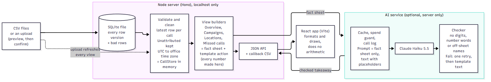

# Technical deep dive

Decisions are in `docs/DECISIONS.md`, the design in `PLAN.md`, setup in `README.md`.

## Architecture and key decisions

The app is one TypeScript package on Node 24 and starts with one command (`npm start` or `docker compose up --build`). It has four parts:

- The data core is pure functions with no I/O: parse, validate, clean, metrics and the four view builders. Nearly all tests live here.
- The server (Hono) has one JSON endpoint per view, the callback CSV, and the built front end. Takeaways have their own endpoint, so a page doesn't wait on AI.
- The AI service runs on the server only, so the key stays out of the browser.
- The web app (Vite, React) formats and draws. It does no arithmetic.

Each view builder returns a fact sheet of named values and entity names. The template sentence, the AI prompt and the AI checker all read that one sheet, so they can't disagree.

| I chose | I rejected |
| --- | --- |
| Vite + React, Hono API | Server-rendered HTML; Next.js |
| SQLite through built-in `node:sqlite` | `better-sqlite3` (a new dependency) |
| Server reads raw tables and runs the same `cleanExport` as the CSV path | Reading a pre-cleaned table, which could drift from the CSV route |
| Model writes placeholders; code fills in values | Free text checked by extracting numbers |
| Haiku 5.5, one takeaway per view | Sonnet or Opus; one takeaway per chart |
| AI on exactly when `ANTHROPIC_API_KEY` is set | A separate `AI_ENABLED` switch |

## Data model and flow

Tables: `raw_calls` (every row version), `campaigns`, `locations`, `bad_rows`, `reference_issues`, `seeds`. Flow: CSV → `raw_calls` → `cleanExport` → in-memory `CallStore` → view builder → fact sheet → UI.

The data is a snapshot read at start. "As of" is the latest call date in the data, not the clock. A newer export goes in with `npm run seed <folder>` and a restart, or through the in-app upload: it previews the changes, writes them in one transaction, then swaps the store and rebuilds the AI service so its cache key follows the data. There is no live feed.

Messy data, with one rule and one test each:

- Several rows share a `call_id`: the latest `updated_at` wins. A bad latest row does not revive an older good one; the call is reported bad. Shipped export: 5,411 rows, 5,000 calls.
- Empty `campaign_id` is "Unattributed" and is kept (144 calls). An unknown non-empty one is a bad row.
- Timestamps are UTC. Dates, hours and weekdays use the office's IANA time zone.
- Revenue counts only on booked calls. Answered calls with no outcome yet are "pending" (41): calls, but in no booking rate.
- Spend is estimated (daily budget × days) and labelled. Cost per booking is blank at a $0 budget, never infinity. A blank or unreadable budget keeps the campaign but blanks its spend figures and leaves it unranked.
- A comparison period the data doesn't fully cover shows no change and says why.
- Bad rows are counted by reason in the data core, the header shows the total skipped, and they don't crash the app. Both exports load with 0.

## Trade-offs, shortcuts, and what I'd do with more time

- Spend and missed-call value are models, not measurements. The page says the missed-call figure likely overstates the loss.
- The app runs on localhost with no login. Every `/api` route refuses a non-local Host header (DNS rebinding) and uploads refuse cross-site requests. Uploads are safe only because of this.
- Docker and `npm start` keep separate AI caches and logs, so each has its own spend cap.
- It is one process with the data in memory, sized for one customer's export.

With more time I would:

1. Simplify the AI spend tracking, which is more elaborate than the app needs.
2. Make upload and seed treat bad rows the same way. A seed stores them in `bad_rows`; an upload reports them and stores nothing.
3. Test in a real browser. Today the click-through tests run in happy-dom.
4. Tighten the takeaway wording. The checker confirms numbers and names, not the sentence around them.

## Failure modes, edge cases, and how I tested

- When the AI fails (no key, 8 s timeout, API error, refusal, malformed JSON, spend limit), the page shows template text and the reason is logged. A checker failure gets one retry with the checker's reason, then template text.
- The checker can't catch an invented name that appears nowhere in the data. The prompt forbids it.
- At startup, a missing folder, file or column prints one `Cannot start: ...` line and exits non-zero. A corrupt, locked or older-schema database is refused with a message and is not deleted or emptied.
- On upload, the server re-checks the file inside the write transaction, so a stale preview can't write the wrong thing. A failure partway rolls back. A file over 10 MB is refused.

`npm test`: 2,341 pass, 17 skipped, 133 files; typecheck is clean. 16 of the 17 are the Docker checks (`npm run test:docker`, need Docker running); the other one is a shutdown test that cannot run on Windows.

- A test per data rule, each on a 5–20 row hand-written fixture, plus table-driven metric tests (zero budget, previous value 0, partial periods, midnight UTC, Phoenix beside a daylight-saving zone, week boundaries, threshold maths).
- Snapshot totals on both exports, identical from the database and from the CSVs; results independent of the machine's time zone.
- A hard-coding guard: every view built on an export with different names, time zones and dates.
- Click-through tests of the whole app in happy-dom.
- AI tests use a fake model: a cache hit makes no call, the guard blocks at the limit, every failure falls back. No automated test calls the real API.

## Performance and scaling

Measured on my Windows machine, Node 24, with the app's own loader and builders. First start includes seeding an in-memory database, reading and cleaning. View times are the median of nine runs. The larger file is the shipped calls repeated ten times under new call ids, so callers and dates repeat.

| | Shipped export | Ten times larger |
| --- | --- | --- |
| Calls (rows) | 5,000 (5,411) | 50,000 (54,110) |
| First start | 186 ms | 1,748 ms |
| Any one view, last 28 days | 0.6 to 4.3 ms | 7 to 49 ms |
| Any one view, all data | 1.0 to 5.6 ms | 14 to 61 ms |
| Memory (process) | 174 MB | 476 MB |

Each request recomputes from the in-memory calls with no precomputed totals. Growth looks roughly linear, and I haven't measured past ten times. Beyond that I would aggregate in SQL or precompute per day.

## AI tools and models, how I checked them, and cost

- To build it I used Claude Code. Sonnet 5.5 planned and built each phase; Opus 5.5 did an adversarial review of each (17). Every phase ended with `npm test` green, shown to me before the next began.
- In the app I use Haiku 5.5 at low effort, with structured JSON, fed the fact sheet only and not raw calls. It writes takeaways and, in the question box, picks a filter from a fixed schema that code validates against the loaded data.
- To check it: the model can't produce a number. The checker runs on every takeaway before display, and a failure falls back to template text. I tested it with one crafted bad output per rejection reason. `npm run ai:try` makes real calls when I choose to.
- It cost $108.80 of $250, almost all on the build (breakdown in `docs/DECISION_SUMMARY.md`); the running app cost about two cents. Takeaways are cached by data, fact sheet, prompt version and model, and the cache persists across restarts. A spend guard (default $5) stops calls past the limit, and every call is logged.
