# Inbound Call Performance: User Guide

This guide shows how to read each page of Inbound Call Performance and what to do with it. The numbered markers on each screenshot match the numbered notes beneath it. The screenshots use the sample data, with the range set to the last 28 days unless stated.

**Starting the app:** see [Commands in the README](../README.md#commands) for setup and the one command that runs it.

## Contents

- [A weekly routine](#a-weekly-routine)
- [The top of every page](#the-top-of-every-page)
- [Overview](#overview-how-did-we-do-and-what-next)
- [Comparing two periods](#comparing-two-periods)
- [Campaigns](#campaigns-which-ones-earn-their-budget)
- [Locations](#locations-is-any-office-different)
- [Missed calls](#missed-calls-who-should-we-call-back)
- [Ask a question](#ask-a-question)
- [Print summary](#print-summary)
- [Upload newer data](#upload-newer-data)
- [Checking the data (optional)](#checking-the-data-optional)
- [Keep in mind](#keep-in-mind)

## A weekly routine

1. **Overview.** Pick the period and read the five tiles and the top actions.
2. **Campaigns.** See which campaigns earn their budget and where to shift it.
3. **Locations.** Check whether any office answers or books differently from the rest.
4. **Missed calls.** Download the call-back list and hand it to the team.
5. **Print summary.** One page for whoever you report to.

## The top of every page

These controls sit above all four pages. Whatever you choose here stays in the web address, so a bookmark or a link you send to a colleague opens the same screen.

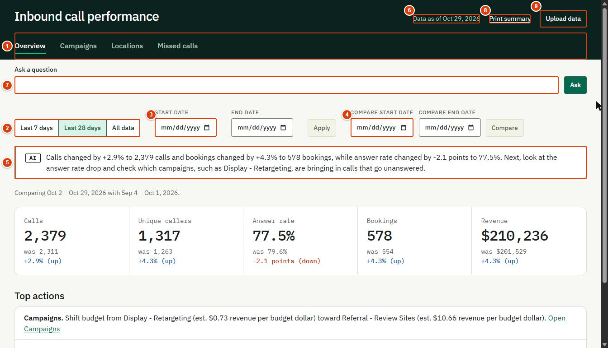

1. **The four pages.** Overview is the summary. Campaigns, Locations and Missed calls each answer one question and end in one thing to do.
2. **Pick the period.** Last 28 days is the default. Every number on the page follows this choice.
3. **Or set your own dates.** Fill in a start and end date, then press Apply.
4. **Compare with another period (optional, on Overview and Campaigns).** Leave it empty and the app compares with the same number of days just before your range.
5. **The takeaway.** A short summary of the page. The tag shows who wrote it: `AI`, or `TEMPLATE` when AI is off or its text failed the checks twice (the AI gets one more try before the app falls back to its own sentence). The numbers always come from the app, never from the AI.
6. **Yellow notes.** They tell you when to read a number with care, for example when the last day may be incomplete.
7. **Data as of.** The latest date in your data. "Last 7 days" counts back from this date, not from today.
8. **Ask a question.** Type a question in plain English. See "Ask a question" below.
9. **Print summary.** A one-page version for reporting up.
10. **Upload data.** Add a newer CSV export.

## Overview: how did we do, and what next?

Start here each week. Five headline numbers, then the single most useful action from each of the other pages.

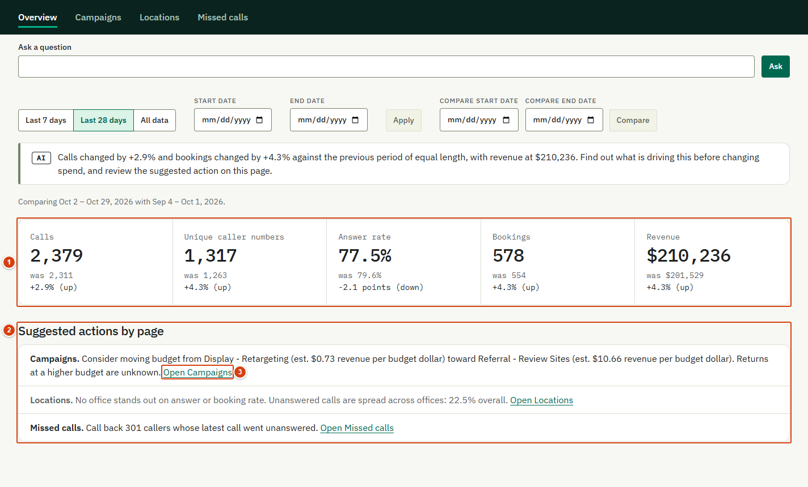

1. **Five headline numbers.** Each tile shows the value now, what it was in the comparison period, and the change. Counts and money change in percent. Rates change in points: 79.6% to 77.5% is "-2.1 points".
2. **Top actions.** One suggestion from each other page, always with the number behind it.
3. **Go to the detail.** Each action links to the page it came from.

## Comparing two periods

On Overview and Campaigns you can compare your range with any other range. If the two are different lengths, the app compares them per day and says so.

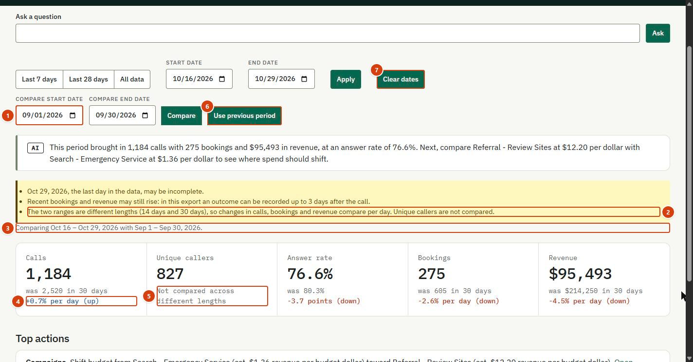

1. **Your comparison range.** Here a 14-day range is compared with a 30-day one.
2. **Different lengths.** The note says the periods are not the same length, so changes are worked out per day.
3. **What is being compared.** The exact dates of both periods.
4. **"per day" on the tile.** The change compares the daily average, so a longer period does not look bigger just because it is longer.
5. **Not compared.** Unique callers cannot be averaged per day fairly, so the tile says so and shows no change.
6. **Back to the default.** Returns to comparing with the period just before.
7. **Clear dates.** Drops your custom range and goes back to the preset.

## Campaigns: which ones earn their budget?

The page opens with what to do, then shows the table behind it.

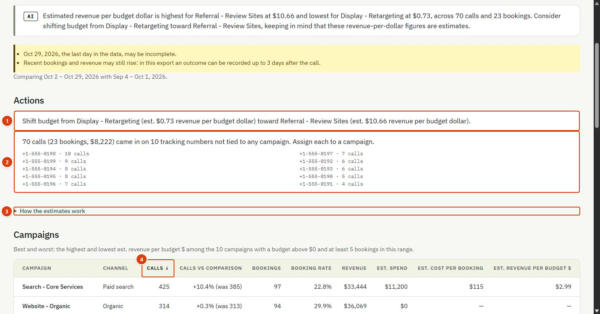

1. **Shift budget.** Names the weakest and the strongest campaign by estimated revenue per budget dollar.
2. **Fix attribution.** Calls that came in on phone numbers not tied to any campaign. Assign these numbers in your call platform so the calls are credited.
3. **How the estimates work.** Click to see the formulas. Spend is not in the data, so it is estimated as daily budget times the days in your range.
4. **Sort the table.** Click any column heading. Your sort stays when you change the date range and is part of the link.

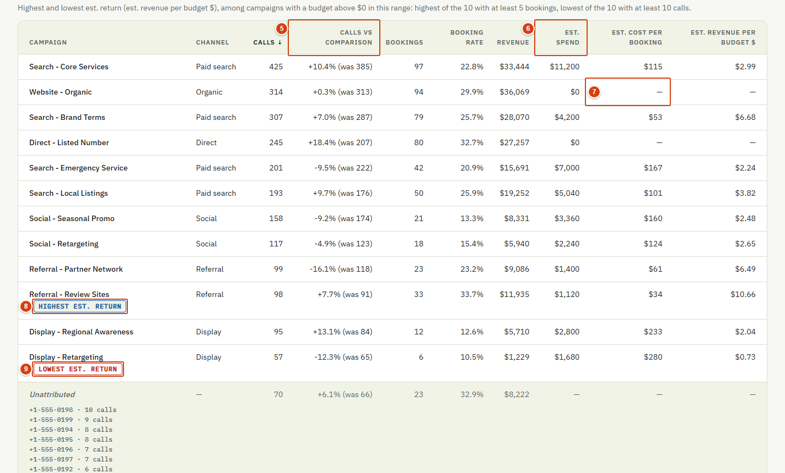

5. **Calls vs comparison.** How each campaign's calls changed against the comparison period.
6. **"Est." columns.** Anything marked est. is an estimate built from the daily budget, not actual spend.
7. **A dash means "not applicable".** Campaigns with a $0 budget, or no budget in the file, have no cost per booking, so the cell is left empty on purpose.
8. **Best.** Highest estimated revenue per budget dollar among campaigns with a budget above $0 and at least 5 bookings in the range.
9. **Worst.** Lowest estimated revenue per budget dollar among campaigns with a budget above $0 and at least 10 calls in the range. A campaign with no bookings at all can be worst. If no two campaigns qualify, or none does worse than the best, nothing is marked and the page says why.

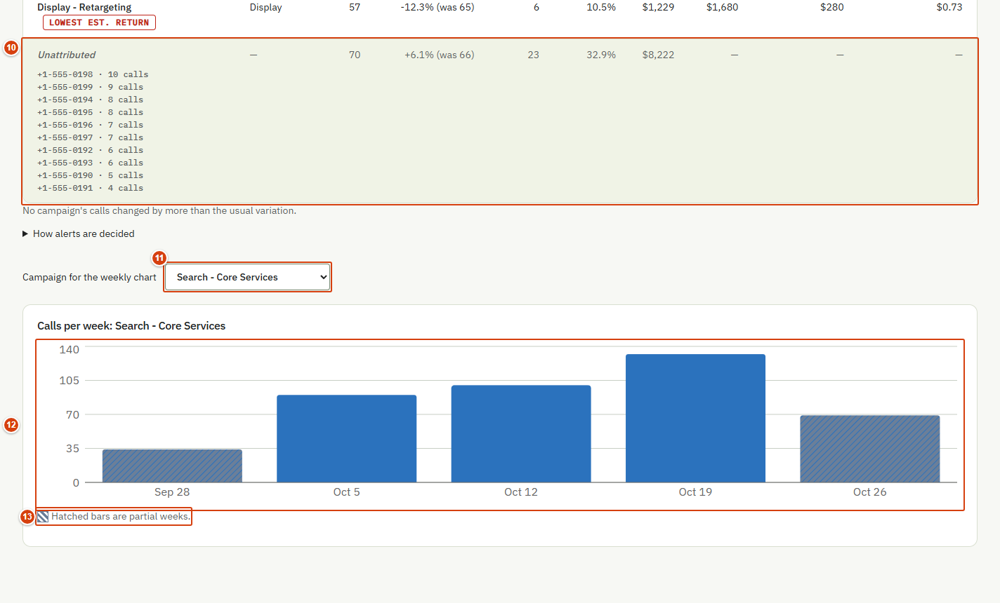

10. **Unattributed.** Calls with no campaign are kept in their own row, never dropped. Their tracking numbers are listed with call counts.
11. **Pick a campaign for the chart.**
12. **Calls per week.** Weeks run Monday to Sunday in each office's local time.
13. **Partial weeks.** A week only partly inside your range or your data is drawn differently, so a short week does not look like a drop.

## Locations: is any office different?

Compares offices on how many calls they answer and how many become bookings.

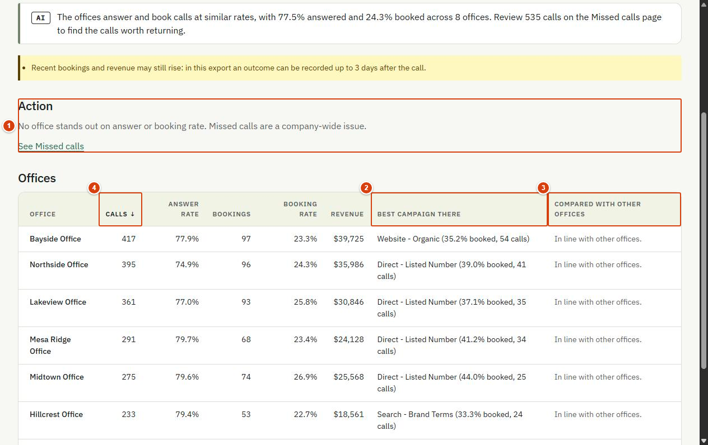

1. **The action.** If an office is doing worse than the rest, it is named here with both rates. "No office stands out" is a real result: it means the differences are within what chance explains. The takeaway then sums up all offices together rather than singling one out.
2. **Best campaign there.** The campaign with the highest booking rate at that office, among campaigns with at least 20 calls there.
3. **Compared with other offices.** Says "better" or "worse" only when the gap is larger than chance explains and the office has at least 50 calls.
4. **Sort** by any column, as on Campaigns.

## Missed calls: who should we call back?

Shows when calls go unanswered, what they may be worth, and a list of people to call back.

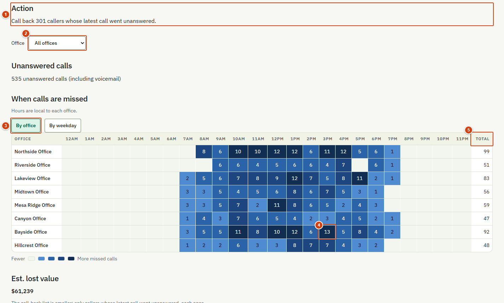

1. **The action.** How many callers to call back and the estimated value of those bookings.
2. **Filter to one office.** The heatmap and the list below follow it.
3. **By office or by weekday.** Switch how the rows are grouped.
4. **Darker means more missed calls.** Each cell is one office and one hour, in that office's local time.
5. **Total** unanswered calls per row.

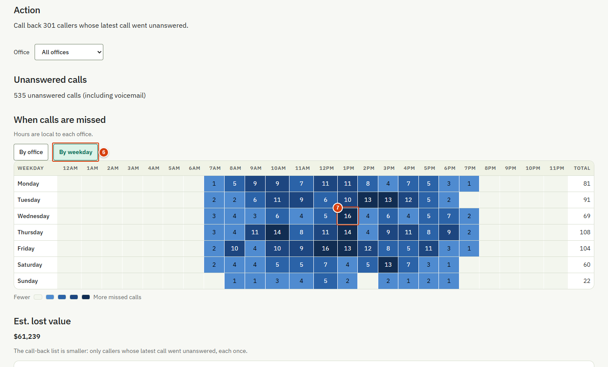

6. **By weekday.** The same calls, grouped by day of the week. Use it to see which shifts need cover.
7. **Busiest slot.** If several slots tie for the most, the action sentence does not single one out.

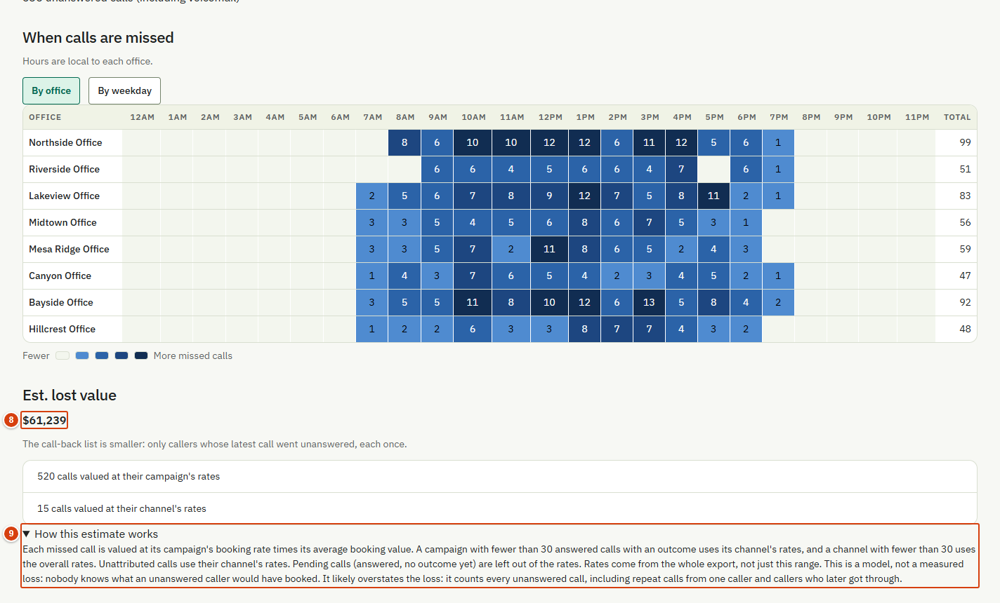

8. **Estimated lost value.** What the unanswered calls might have been worth. It is an upper bound: it counts every unanswered call, including repeat attempts and callers who got through later.
9. **How this estimate works.** Click to see the formula: each missed call is valued at its campaign's usual booking rate times its average booking value.

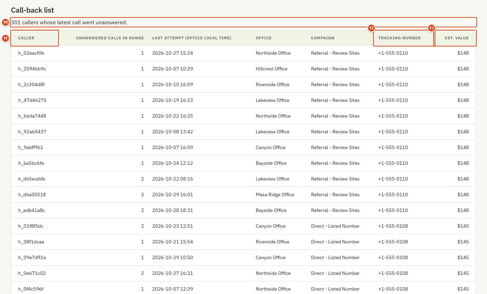

10. **The call-back list.** Callers whose latest call in the range went unanswered and who have not been answered since.
11. **Caller.** The export only has a scrambled caller ID, not a phone number. Match it in your call platform using the tracking number and time.
12. **Tracking number** the caller dialled.
13. **Est. value.** The estimate for that caller's latest missed call. The list is sorted by it, highest first.

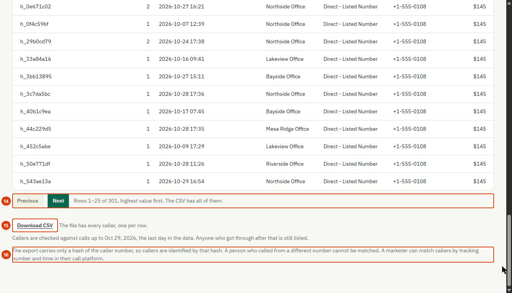

14. **25 callers per page.**
15. **Download CSV.** The whole list for your range, ready to hand to the team making the calls.
16. **Why there are no phone numbers.** A reminder of what the export does and does not contain.

## Ask a question

Type a question about offices, campaigns, weekdays, hours or dates. The AI only turns your words into a filter. The app then runs that filter and works out every number itself. This needs AI to be switched on.

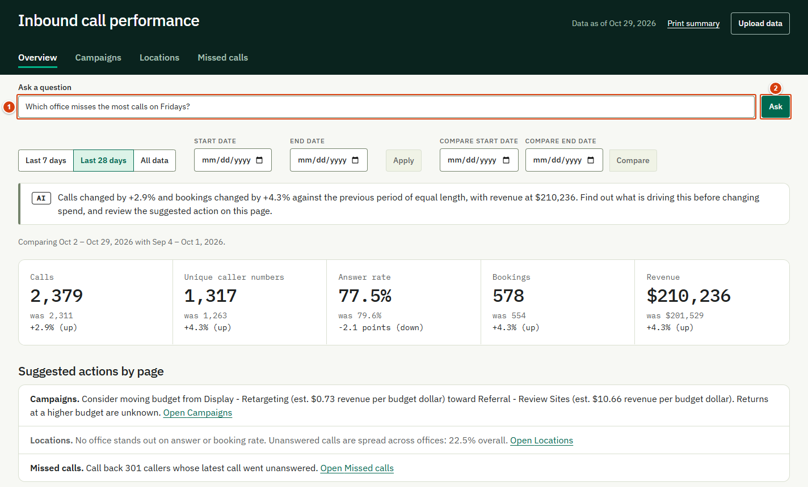

1. **Type the question.** For example: "Which office misses the most calls on Fridays?" or "How did Search - Brand Terms do last week?"
2. **Ask.** While it is working, the button becomes Cancel.

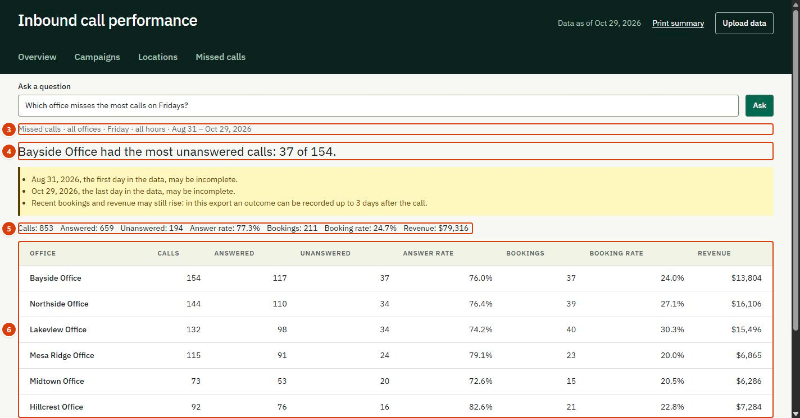

3. **How your question was read.** Check this line first. Here: missed calls, all offices, Fridays, all hours, all dates. If it is not what you meant, reword and ask again.
4. **The answer.** Here Bayside Office had 37 unanswered calls out of its 154 Friday calls.
5. **Totals** for everything the filter matched.
6. **The rows behind the answer,** so you can see the runners-up.

If the app cannot turn the question into a filter, it says so and nothing is shown. Questions about things that are not in the data, such as why something happened, cannot be answered.

## Print summary

One page with the headline numbers, the takeaways and the action from each page, for the range and comparison you had open.

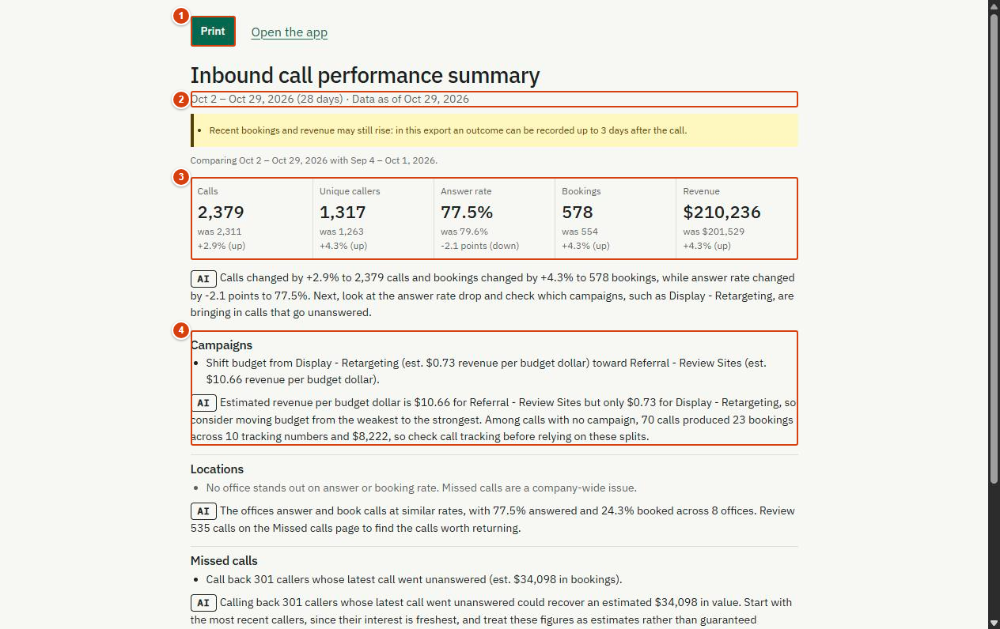

1. **Print,** or save as PDF from your browser's print window.
2. **The range** and data date are printed at the top, so the page explains itself.
3. **The same five numbers** as Overview.
4. **One block per page,** each with its takeaway and action.

## Upload newer data

When you have a newer export, add it here. You upload one CSV at a time: calls, campaigns or locations. The app works out which one it is from the column names.

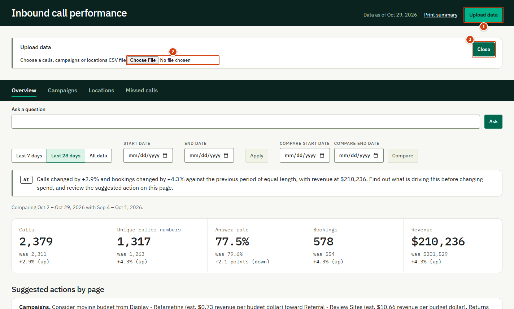

1. **Open the panel.**
2. **Choose a CSV.** The app first shows a preview: how many rows are new, already stored, or have a problem. Nothing is saved until you confirm.
3. **Close.** After rows are added, the page refreshes to the new data and "Data as of" moves to the new latest date.

A newer row for a call you already have replaces the older one. Rows with a problem are counted and reported; they never stop the upload.

## Checking the data (optional)

Add `?dev` to the end of the web address to show a Data notes button. It lists what the app cleaned up when it loaded your export. You do not need it day to day; it is there when a number looks off.

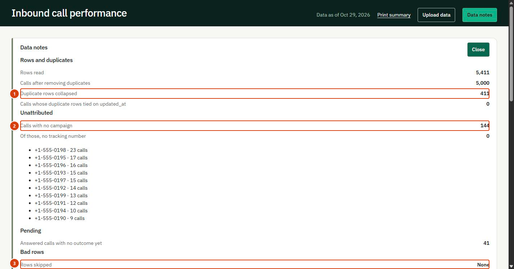

1. **Duplicate rows.** The export can hold several rows for one call. The app keeps the latest one.
2. **Unattributed calls** and the tracking numbers they came in on.
3. **Rows skipped.** Rows the app could not use, counted by reason. If any exist, the header also says so on every page.

## Keep in mind

- **"Est." means estimate.** Spend is not in the export. It is worked out as daily budget times the number of days, so cost per booking and revenue per budget dollar are estimates too.
- **Lost value is an upper bound.** It counts every unanswered call. The call-back list total is the more realistic figure, because it counts each caller once.
- **Best and worst do not rank every campaign.** Best needs at least 5 bookings and worst needs at least 10 calls, both with a budget. A campaign below both, or with no budget in the file, is not ranked, so scan the table as well.
- **Trust the Action line over the takeaway.** An AI takeaway uses only real numbers and names, but the app cannot check that the sentence around them is worded well. The Action lines are written by the app itself.
- **Recent days can still change.** Bookings and revenue are sometimes recorded a few days after the call. The yellow note tells you when your range is affected.
- **Times are local to each office.** A 9 AM call in Phoenix and a 9 AM call in New York both show as 9 AM.
